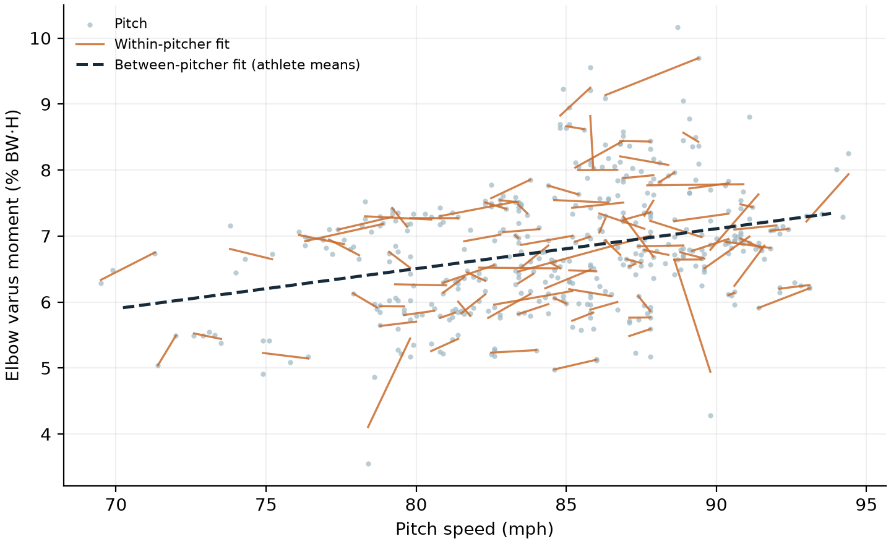
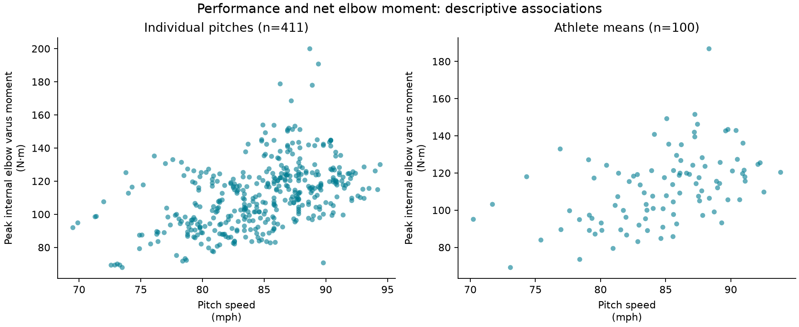
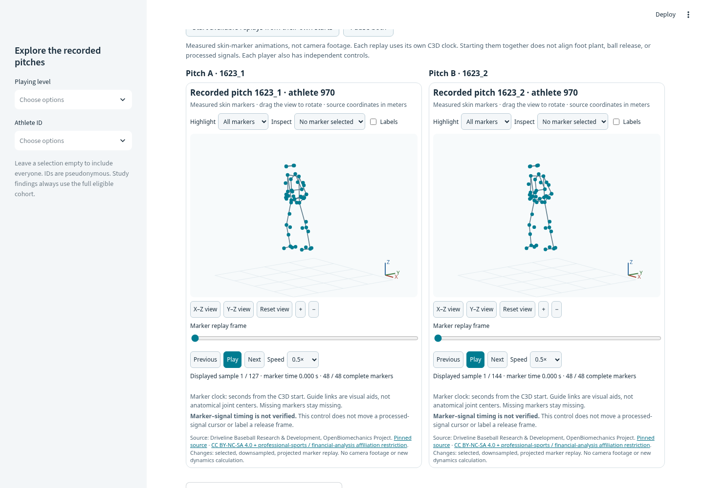

# Pitching Performance and Elbow Loading

Reproducible analysis of **411 fastballs from 100 pitchers** in Driveline's open OpenBiomechanics dataset. It asks two questions. Do rotational measures predict pitch speed and elbow loading for pitchers a model has never seen? And is elbow loading mostly a stable pitcher trait or a pitch-to-pitch change?

**[Open the live dashboard](https://pitching-performance-elbow-loading-app-ready-bpn9pb4j3udcqxo9k.streamlit.app/)** · [Two-page research brief (PDF)](docs/research_brief/research-brief.pdf) · [Study summary](docs/STUDY_SUMMARY.md) · [Pitcher vs. pitch variation](docs/ATHLETE_VARIATION.md) · [Automated checks](https://github.com/owengarrett20-svg/pitching-performance-elbow-loading-github-ready/actions)

**Author:** Owen Garrett · [contribution and AI-assistance record](docs/CONTRIBUTIONS_AND_AI.md) · Version 0.8.0

## Key findings

1. **Rotation adds information about speed.** For held-out athletes, adding peak shoulder internal rotation velocity, hip–shoulder separation, and torso rotation velocity to age, mass, and height lowered equal-athlete speed error by 0.39 mph (95% conditional interval 0.03–0.75 mph). For elbow moment, the 0.30 N·m improvement was uncertain; its interval includes zero.
2. **Pitchers differ far more than pitches do.** About 98% of speed variance and 92% of body-size-scaled elbow-moment variance lie between pitchers. Within a session, speed varies by about 0.6 mph.
3. **Faster pitches carry more scaled elbow moment, within and between pitchers.** Within one pitcher's session, +1 mph is associated with +0.072 %BW·H (95% interval 0.027–0.116), about 1.1% of the cohort mean. The between-pitcher slope (0.061) was not distinguishable from it.

These are retrospective associations in a mostly collegiate cohort. Internal net elbow varus moment is a joint-loading measure, not UCL force or injury probability, and the dataset has no injury outcomes. The [research brief](docs/research_brief/research-brief.pdf) and [release verification](docs/PHASE5_VALIDATION.md) record what has and has not been checked; peer review and external validation remain separate.



## Research question

Do completed-pitch rotational summaries add predictive information beyond age, body mass, and height for pitch speed and peak internal elbow varus moment in held-out athletes?

A follow-on exploratory analysis asks how much speed and elbow-moment variation lies between rather than within pitchers, and whether the speed–moment slope differs within a session and across pitchers ([details](docs/ATHLETE_VARIATION.md)).

Phase 1 established the data audit and combined baseline. Phase 2 compares fixed predictor groups and quantifies conditional error contrasts. Its plan was committed before the new comparisons, after the Phase 1 results had been viewed. This is an exploratory follow-on, not a preregistered or independent confirmatory study.

This project emphasizes transparent data preparation, biomechanical interpretation, reproducible analysis, and evaluation that accounts for repeated pitches from the same athlete.

The models describe retrospective associations. Internal elbow varus moment is a joint-loading measure, not UCL force or injury probability. The dataset contains no injury outcomes.

## Study at a glance

| Item | Description |
| --- | --- |
| Data source | Driveline’s OpenBiomechanics Project |
| Sample | 411 fastball pitches from 100 athletes |
| Sessions | 100; one released session per athlete |
| Outcomes | Pitch speed and peak internal elbow varus moment |
| Baselines | Training-fold mean; anthropometric, kinematic, and combined ridge models |
| Validation | Five shared athlete-grouped folds; primary seed 42 |
| Primary Phase 2 metric | Equal-athlete mean absolute error (MAE) |
| Conditional uncertainty | 5,000 paired athlete-cluster resamples of fixed out-of-fold errors |
| Partition sensitivity | Ten full-refit partitions, seeds 42–51; descriptive, not independent replications |
| Dashboard | Streamlit |
| Environment | Python 3.12 with dependencies pinned in `uv.lock` |

The cohort is primarily collegiate, with recorded pitch speeds from 69.5 to 94.4 mph. Results should not be assumed to represent MLB pitchers or other populations.



*Descriptive associations, without causal or injury-risk interpretation. Source: Driveline Baseball Research & Development, OpenBiomechanics Project. Figure adapted by this project under the data terms described below.*

## Licensing and permitted use

Original project software is licensed under the [MIT License](LICENSE).

OBP data, source definitions, and derived material—including reference reports, figures, traces, and marker animations—retain **CC BY-NC-SA 4.0 plus an additional professional-sports/financial-analysis affiliation restriction**.

Upstream restricts use by employees, contractors, associates, and significant shareholders of professional sports organizations or financial-analysis firms. Such use requires a specific written paid license from the licensor.

The software’s MIT license does not override these data restrictions. Review the [licensing notes and retained upstream terms](docs/LICENSING.md) before reuse, redistribution, commercial activity, or professional-team work.

This is an independent research portfolio project and does not imply endorsement by Driveline.

## Explore the dashboard



*Local Phase 5 browser previews. [Opening view](docs/images/dashboard-overview.png) ·
[Phone-width opening](docs/images/dashboard-mobile.png) ·
[Phone-width pitch workspace](docs/images/pitch-workspace-mobile.png) ·
[Research brief](docs/images/research-brief.png).
The existing [athlete reports](docs/images/athlete-reports.png) and
[dedicated motion lab](docs/images/motion-lab.png) remain available.
Measured-marker views and source-derived previews retain the data terms above.*

The [live dashboard](https://pitching-performance-elbow-loading-app-ready-bpn9pb4j3udcqxo9k.streamlit.app/) provides eight views:

- **Start here:** the research question, a genuine marker replay, and the main finding in plain language.
- **Research brief:** a concise source-derived case study, evidence boundaries, contribution record, and downloadable HTML/Markdown/provenance.
- **Explore pitches:** search the recorded-pitch table, then click a row or a chart point to open Pitch A or Pitch B and inspect side-by-side marker replays, source markers, measurements, and cohort percentiles. Charts and athlete averages remain available under **Charts & associations**.
- **Watch motion:** an interactive 3D measured-marker lab, frame and trace inspection, source-clock limitations, and the existing replay and measurement lessons.
- **Athlete reports:** self-contained, printable HTML reports and source-attributed downloads describing the selected athlete's available recorded pitches and verified saved errors.
- **Study results:** a readable average-error comparison, the pitcher-versus-pitch variation analysis, prediction errors, and the detailed research audit.
- **New-data lab:** local audit and frozen-evaluation instructions, reviewed mapping/protocol templates, and explicit readiness requirements. It does not accept athlete-file uploads.
- **Methods & collaboration:** the author and evaluation process, data-quality reports, definitions, and a public introduction route for a future authorized study.

Athlete identifiers are pseudonymous source identifiers. Repeated pitches from one athlete are clustered observations.

Dashboard filters change displayed pitch subsets and athlete-detail tables without retraining models. Phase 2 scores, intervals, and partition-sensitivity summaries always describe the complete eligible cohort; sidebar filters do not recompute them. Subset Phase 1 error summaries are labeled separately from complete cross-validation results.

Only the active view is rendered. The opening keeps research tables behind deliberate navigation, while the full methods and uncertain findings remain available.

The default **Explore pitches → Find & compare pitches** workspace uses a selectable source table. Search an exact identifier with `pitch 1623_3` or `athlete 970`, or use literal free-text/numeric terms. A row or chart click fills Pitch A or Pitch B, as chosen; Pitch B can be any observation in the filtered table. Swap A and B, or step Pitch B through Pitch A's athlete's other pitches. A no-result search clears the replay panes. Keyboard/touch selectors provide an alternative to table selection. Both panes retain their exact pitch and athlete IDs; unavailable or corrupt motion is explained without substituting another recording.

Under **Charts & associations**, a point can represent either one recorded pitch or an athlete average. An athlete average summarizes paired observed pitches and is not a single delivery or a time-averaged motion trace. A/B comparisons calculate differences between measured observations; they do not simulate a mechanics change, rank technique quality, or prescribe an intervention. Missing measurements remain missing.

Recorded comparisons can be shared through a page address such as `?page=explore&pitch=1623_3&compare=2916_4`. URL values are checked against actual recorded identifiers. Prepared motion is shown only for matching pitch and athlete identities; the address reflects the replay actually displayed.

The [workspace guide](docs/PITCH_WORKSPACE.md) describes search and selection behavior. Earlier phase scopes and upgrade guides are kept in [docs/archive](docs/archive/README.md).

### Motion, reports, and new-data tools

The [verified marker catalog](docs/PITCH_CATALOG.md) provides a playable measured-marker replay for all 411 study pitches, matched to source pitch and athlete identities. The [motion lab](docs/MOTION_LAB.md) uses that catalog, with the original three examples retained as a fallback. Detailed processed traces and MP4 animations remain available for the original three examples. Marker and signal controls stay independent because their clock relationship has not been verified. Starting two recordings from their own first samples is a playback convenience, not alignment to foot plant, ball release, or a common movement phase. Matching rates, lengths, or peaks does not establish synchronization or reproduce inverse dynamics.

[Athlete research reports](docs/ATHLETE_REPORTS.md) describe the recorded sample in physical units, preserve missing values, and include saved held-out errors only when source identities and measurements match. The source has one released session and a few pitches per athlete; a report does not establish longitudinal development, stable consistency, technique quality, or injury risk. Save the downloaded HTML directly, or use the browser's **Print → Save as PDF**.

The [new-data guide](docs/NEW_DATA_GUIDE.md) explains local column mapping, units, definitions, sign conventions, provenance, and permission declarations. The [external-evaluation guide](docs/EXTERNAL_VALIDATION.md) separates development-model freezing from evaluation on a new-athlete cohort. It uses safe numerical JSON artifacts and frozen preprocessing rather than executable model deserialization.

**Workflow readiness is separate from scientific evidence:** these tools are implemented for a future appropriately authorized study. This release contains no new external-cohort result, external-performance claim, prospective forecast, or injury outcome.

### What the research brief verifies

The [research brief](docs/RESEARCH_BRIEF.md) reads the verified cohort and saved Phase 2 findings. The [measurement audit](docs/MEASUREMENT_VERIFICATION.md) explicitly checks four released signal maxima against four released POIs in each of three prepared trace examples: twelve selected source-summary checks. It preserves missing boundary samples. Passing those checks reproduces released scalar summaries; it does not independently validate source filtering, anatomical frames, inverse dynamics, timing, or every quantity in all 411 pitches.

The project is an independent **AI-assisted research software portfolio**. Project framing, interface review, implementation assistance, agent-executed tests, and personally completed method review are documented separately. A source repository or passing test suite does not establish that an applicant personally wrote or independently replicated every method. Tailored CV/application drafts and the uploaded CV remain outside this public repository.

### Interested in a research collaboration?

Start with a focused question, measurement definitions, units, collection protocol, and approximate cohort/session counts. The [collaboration guide](docs/COLLABORATION.md) describes a proposed evaluation process for independently authorized data.

The site's introduction link opens a **public GitHub issue**. Share only a non-sensitive project introduction there. Agree a private communication channel, data rights, and an approved analysis environment before any athlete-data transfer. The local new-data tools do not create a confidential public upload service, team partnership, or completed external benchmark.

OBP's professional-sports/financial-analysis affiliation restriction still applies. The original software's MIT license does not grant permission to use OBP material in team work.

## Quick start: run the reference dashboard

Install [uv](https://docs.astral.sh/uv/getting-started/installation/), then clone the repository:

```bash
git clone https://github.com/owengarrett20-svg/pitching-performance-elbow-loading-github-ready.git
cd pitching-performance-elbow-loading-github-ready
```

Install the locked environment and start the reference dashboard:

```bash
uv sync --frozen
uv run --frozen streamlit run streamlit_app.py
```

Open the local URL printed in the terminal.

The reference dashboard uses a bundled, checksum-verified snapshot. It requires no source-data download, model fitting, MATLAB installation, or large motion-capture archive.

Prepared visual assets are included. Viewing them does not require FFmpeg or the optional motion-processing dependencies.

## Reproduce the analysis

The analysis environment uses **Python 3.12**, tested with Python 3.12.14 and uv 0.12.23. The exact dependency graph and package hashes are recorded in `uv.lock`.

Run these commands from the repository root:

```bash
# Install analysis and development dependencies.
uv sync --frozen --extra dev

# Download and verify the small pinned source files.
uv run --frozen pitching fetch

# Validate source tables, join cardinality, and missingness.
uv run --frozen pitching audit

# Rebuild Phase 1, then run all planned Phase 2 comparisons and reports.
uv run --frozen pitching phase2 --offline

# Run tests and code checks.
uv run --frozen pytest -q
uv run --frozen ruff check src tests scripts app.py streamlit_app.py
uv run --frozen ruff format --check src tests scripts app.py streamlit_app.py

# Open the dashboard using the locally regenerated reports.
uv run --frozen streamlit run app.py
```

Alternatively, this command fetches absent source files, verifies the cache, and runs both phases:

```bash
uv run --frozen pitching phase2
```

`pitching phase2` deliberately rebuilds Phase 1 before Phase 2. `pitching run` remains the Phase 1-only command: it removes the completed-run binding to any older Phase 2 outputs so the dashboard cannot display those as current results. To regenerate Phase 2 afterward, run `pitching phase2` again.

The analysis downloads nine small CSV/documentation/license files totaling less than 0.4 MB. Neither analysis phase requires large C3D archives or camera footage.

Generated OBP analysis outputs are written to `reports/`. Downloaded source files are cached under `data/raw/`. New-data studies should stay under ignored `local_studies/`, outside the public reference snapshot. Keep source files, identity mappings, model bundles, and evaluation outputs within the approved local or organizational environment. These working directories are excluded from Git; review files before any commit or publication.

See [reproducibility notes](docs/REPRODUCIBILITY.md) and the [Windows guide](START_HERE_WINDOWS.md) for additional setup information.

## Data source and provenance

The analysis uses Driveline Baseball Research & Development’s [OpenBiomechanics Project](https://github.com/drivelineresearch/openbiomechanics), pinned to:

```text
44b98dae05cceb016f080ab39d105c85b8639084
```

The primary source files are:

```text
baseball_pitching/data/poi/poi_metrics.csv
baseball_pitching/data/metadata.csv
```

The official POI and metadata loaders use `pandas.read_csv`. This project loads the files using their documented schema directly.

`source_manifest.json` records source paths, sizes, and SHA-256 checksums. Downloads use HTTPS with normal TLS verification. A checksum mismatch stops the workflow.

### Join validation

The tables are joined using `session_pitch`, with athlete grouping identified by `user`.

Validation checks include:

- Nonempty, unique pitch identifiers in both tables.
- Complete matching coverage between POI and metadata.
- A one-to-one join without row multiplication.
- Agreement between overlapping session and observed-speed fields.
- Consistent athlete assignments within sessions.
- Conformance with the pinned POI data dictionary.

Missing target values are never filled from metadata’s duplicate pitch-speed field.

### Missing-data findings

For the pinned source:

- Both tables contain 411 unique pitch identifiers.
- All 411 pitches match one-to-one.
- There are no missing observations in the five focal measures or six model predictors.
- Twenty-five other POI columns each contain eight missing observations.

Missingness is reported by column for the source and merged tables. Missing measurements remain missing in the analysis tables.

## Biomechanical variables

| Source variable | Interpretation | Units |
| --- | --- | --- |
| `pitch_speed_mph` | Recorded pitch speed | mph |
| `elbow_varus_moment` | Peak internal net elbow varus moment | N·m |
| `max_shoulder_internal_rotational_velo` | Peak shoulder internal rotation angular velocity | deg/s |
| `max_rotation_hip_shoulder_separation` | Peak thorax–pelvis separation angle | deg |
| `max_torso_rotational_velo` | Peak torso axial rotation velocity | deg/s |

Peak hip–shoulder separation differs from separation measured specifically at foot plant.

These peaks can occur at different instants. Their magnitudes alone cannot establish the timing of a kinematic sequence or quantify energy transfer between segments.

Internal net elbow moment depends on the source biomechanical model and its assumptions. It does not isolate tissue-specific loading or establish a safe threshold.

See [variable definitions](docs/VARIABLES.md) for source references and measurement conventions.

## Exploratory analysis

The workflow produces:

- Distributions of all five focal variables.
- Pitch-level speed–moment associations alongside athlete means.
- Rotational measures plotted against both outcomes.
- Held-out observed-versus-predicted plots and residual plots.

Measured values, including unusual observations, are retained.

The plots are descriptive. Repeated pitches are not treated as independent observations for significance testing, and associations are not converted into causal coaching recommendations.

## Modeling approach

### Outcomes

Two separate prediction tasks estimate:

1. Pitch speed in mph.
2. Peak internal elbow varus moment in N·m.

### Predictors

The Phase 1 combined model uses six predictors:

- Age.
- Body mass.
- Height.
- Peak shoulder internal rotation velocity.
- Peak hip–shoulder separation.
- Peak torso rotation velocity.

Phase 2 keeps these definitions and compares age/mass/height only, the three rotational measures only, and all six combined. The anthropometric group includes age as well as body-size measures.

Both outcome columns, athlete/session identifiers, and filenames are excluded from every predictor matrix. This matters because source filenames encode pitch speed.

### Baseline models

The comparison includes:

- **Training-fold mean:** predicts the average outcome observed in the training athletes.
- **Ridge regression:** a regularized linear model with `alpha=10`.

The Phase 1 combined specification is retained unchanged. All Phase 2 ridge models use `alpha=10` with the same training-fold preprocessing and shared athlete partitions. The [Phase 2 plan](docs/PHASE2_ANALYSIS_PLAN.md) fixes predictor groups, contrasts, resampling, and sensitivity settings before the new comparisons. There is no hyperparameter search against these validation results.

### Athlete-grouped evaluation

Five-fold shuffled `GroupKFold` uses athlete identifier `user` and random seed 42.

Every athlete’s pitches remain together in one held-out fold. Each fold contains 20 held-out athletes, while pitch counts vary. Both prediction tasks use the same athlete partitions.

Median imputation, missingness indicators, and standardization are fitted inside each training fold. Outcomes are never imputed. The focal pinned data contain no missing model predictors; the imputation procedure defines behavior for eligible missing predictors without treating estimates as measured data.

Because the predictors summarize the completed pitch, this is retrospective prediction. It does not forecast performance before the delivery.

See the [research plan](docs/RESEARCH_PLAN.md) for the evaluation specification.

## Phase 1 baseline results

Pooled out-of-fold results from 411 pitches and 100 athletes:

| Outcome | Model | MAE | RMSE | R² | Equal-athlete MAE |
| --- | --- | ---: | ---: | ---: | ---: |
| Speed, mph | Training mean | 3.828 | 4.735 | -0.010 | 3.807 |
| Speed, mph | Ridge | 3.037 | 3.876 | 0.323 | 3.153 |
| Elbow moment, N·m | Training mean | 15.636 | 19.791 | -0.017 | 15.662 |
| Elbow moment, N·m | Ridge | 12.395 | 15.885 | 0.345 | 12.104 |

MAE and RMSE retain the outcome’s physical units.

**Pooled MAE** weights every pitch equally. **Equal-athlete MAE** first averages absolute errors within each athlete, then weights athletes equally.

Ridge improves on the training-mean baseline in this cohort, while substantial prediction error remains. These results describe internal validation on withheld athletes from the same source setting.

Fold-level variation is saved in `fold_metrics.csv`. It is not a confidence interval. Phase 2 adds explicitly conditional paired error intervals, described below. No external validation, prospective forecasting, or injury prediction is claimed.

## Phase 2: what do the rotational summaries add?

The primary score is **equal-athlete MAE**: mean absolute error is calculated within each athlete, then averaged equally across athletes. This prevents athletes with more recorded pitches from dominating the comparison.

All models use the same five athlete-grouped folds, with seed 42. Both outcomes include 411 pitches from 100 athletes. The table reports saved primary-partition results, rounded to three decimals:

| Predictor group | Speed equal-athlete MAE, mph | Elbow moment equal-athlete MAE, N·m |
| --- | ---: | ---: |
| Training-fold mean | 3.807 | 15.662 |
| Age, mass, height | 3.542 | 12.404 |
| Three rotational measures | 3.530 | 15.557 |
| Combined six predictors | 3.153 | 12.104 |

The primary contrast is **combined minus anthropometric equal-athlete MAE**. Negative values favor the combined model:

| Outcome | Error difference | Conditional 95% interval |
| --- | ---: | ---: |
| Pitch speed, mph | -0.389 | [-0.749, -0.029] |
| Elbow moment, N·m | -0.299 | [-1.218, 0.628] |

For speed, the combined model has lower observed error and its conditional interval does not include zero. For elbow moment, its smaller observed improvement has an interval that includes zero. The current analysis therefore leaves the incremental value of these rotational summaries for elbow-moment prediction uncertain. Kinematics alone also perform much worse than the anthropometric model for elbow moment in this cohort. All planned contrasts are retained, including unfavorable findings.

The intervals use 5,000 paired athlete-cluster percentile resamples, seed 20261019. Each sampled athlete contributes all eligible pitches with their sampled multiplicity. Predictions are **fixed** within the resamples: these intervals exclude model-refitting, full training-set, model-selection, external-cohort, and measurement uncertainty. Overlapping cross-validation training sets further limit their sampling interpretation. They are per-comparison exploratory summaries, without multiplicity adjustment or a formal significance claim.

Ten complete model evaluations refit preprocessing and models for partition seeds 42–51. The primary contrast ranges from -0.430 to -0.213 mph for speed and -0.398 to -0.037 N·m for elbow moment. These overlapping partitions reuse the same athletes; their range is descriptive sensitivity, not a confidence interval or ten independent replications.

Read the [complete Phase 2 report](docs/PHASE2_RESULTS.md), [analysis plan](docs/PHASE2_ANALYSIS_PLAN.md), and [machine-readable reference outputs](assets/demo/reports/phase2). No lower prediction error establishes a causal mechanics change or an injury-risk result.

## Motion examples and measurement explanations

The [catalog](docs/PITCH_CATALOG.md) links all 411 study pitches to measured-marker arrays from the checksum-verified official C3D archive. It preserves source identities, coordinates, sampling, missingness, and transformations. The three original MP4/processed-trace examples have recorded speeds of 69.5, 85.3, and 94.4 mph.

### Interactive marker lab and measured animations

The lab and animations use released C3D skin-marker observations linked to study pitches through source metadata. The lab adds a rotatable 3D view and independent inspection of marker frames and processed signals. Its source audit does not claim a verified marker–signal time mapping.

They include:

- Interactive marker inspection alongside the existing half-speed replay.
- A paused-frame inspector and explicit marker-frame sampling information.
- Source and preparation provenance.
- Explanations of the limits of marker-based visualization.

These are marker animations rather than camera recordings or independently validated joint-center skeletons. Missing marker observations are not interpolated.

### Processed signal traces

Released angle, angular-velocity, and moment traces are linked to the original three example pitches. These detailed traces are a separate evidence subset from the full marker catalog.

The viewer allows selection of a time interval and comparison of its maximum with the published POI value. For each of the three examples, four full-trace maxima agree numerically with the corresponding POI values: twelve selected source-summary checks in total. This agreement does not independently validate the upstream kinematic or inverse-dynamics pipeline.

The native shoulder-velocity signal is preserved. A documented ambiguity between generic upstream angle signs and the released velocity convention remains unresolved.

Marker-frame and processed-signal clocks have not been independently aligned. The viewer does not claim synchronized event frames or overlays.

### Instructional video

A short original schematic animation and five measurement lessons explain the concepts behind the focal variables. The schematic is labeled as instructional material and does not represent another measured pitch.

### Separate camera example

The dashboard links an official 62.7 mph OBP-CV camera demonstration. It has no verified crosswalk to the 411-pitch study table and is kept separate from study-pitch metrics.

External playback depends on the source’s availability and sharing settings. No synchronized camera coverage is assumed for the dataset.

This project does not scrape or redistribute copyrighted MLB footage or calculate elbow joint moments directly from a single video.

See [video methods and provenance](docs/VIDEO_METHODS.md) for details.

## Reproducibility and automated checks

The repository includes tests for:

- Join cardinality, duplicate keys, and conflicting metadata.
- Target preservation and missing-data summaries.
- Source and artifact checksum validation.
- Forbidden predictor exclusion.
- Disjoint athlete folds and training-fold preprocessing.
- Deterministic predictions and metric calculations.
- Shared Phase 2 folds, paired athlete resampling and duplicate-athlete weighting.
- Reproduction of the Phase 1 mean and combined predictions.
- Full-refit partition sensitivity and generated Phase 2 reports.
- Dashboard filters, error handling, and stale-result protection.
- Hosted reference-snapshot integrity.
- Allowlisted share links, recorded-pitch selection, filter/selection state, observed A/B arithmetic, athlete-average units, and readable verified findings.
- Non-sensitive collaboration links and clear data-use boundaries.
- Athlete report missingness, source/error matching, HTML escaping, and printable downloads.
- New-data schema, deterministic unit conversion, grouping, permission declarations, and artifact integrity.
- Frozen numerical model predictions, absence of evaluation-time fitting, overlap rejection, and descriptive external-error calculations.

Synthetic test fixtures are labeled and never enter the reported research results.

Real-data integration tests require the verified source cache; run `pitching fetch` before testing. Some archive-dependent motion checks require optional dependencies and source archives and skip when those inputs are unavailable.

GitHub Actions installs the locked environment, fetches the small pinned sources, checks formatting and dependencies, and runs tests.

Each completed local analysis records:

- Source revision.
- Producing project Git revision and working-tree status.
- Code, source-manifest, and lockfile hashes.
- Python and library versions.
- Evaluation settings.
- Generated-artifact checksums.

A completion marker and artifact hashes prevent partially refreshed reports from being displayed as a completed model evaluation.

The `.gitattributes` rules preserve checksummed asset bytes across operating systems, including Windows Git checkouts.

## Hosted dashboard

The deployed dashboard uses:

| Setting | Value |
| --- | --- |
| Repository | `owengarrett20-svg/pitching-performance-elbow-loading-github-ready` |
| Branch | `main` |
| Entry point | `streamlit_app.py` |
| Python | 3.12 |

Two entry points support different workflows:

- **`streamlit_app.py`:** reads the committed, verified reference snapshot in `assets/demo`.
- **`app.py`:** reads locally regenerated reports.

Neither entry point downloads source data, fits models, or bootstraps data during a browser interaction. New-data auditing and external-model freezing/evaluation run through explicit local CLI commands. They do not run from the hosted public dashboard. Altair supports the interactive charts; its runtime version is pinned alongside the analysis dependencies.

To deliberately refresh the published reference snapshot after an analysis change:

```bash
uv run --frozen pitching phase2
uv run --frozen python scripts/export_demo_snapshot.py
```

The exporter checks the producing code, source manifest, lockfile, Phase 2 plan, and output hashes before export. Commit the refreshed snapshot and manifest together. The parent completion marker binds the child Phase 2 metadata and artifacts; a partial run or Phase 1-only refresh cannot silently publish older Phase 2 results.

See the [publication and deployment guide](docs/GITHUB_PUBLISH.md) for maintenance instructions.

## Limitations

- The sample is small, fastball-only, primarily collegiate, and drawn from one source setting.
- One released session per athlete prevents evaluation on future sessions within this dataset.
- Same-pitch kinematic summaries do not establish pre-pitch forecasting.
- Held-out-athlete evaluation within this source does not establish external validity.
- Marker-based kinematics and inverse-dynamics moments depend on filtering, segment models, coordinate conventions, and soft-tissue artifact.
- Individual peaks do not reconstruct movement sequencing.
- No injury outcomes or validated clinical thresholds are available.
- Downloadable athlete reports describe a few recorded pitches and cannot establish long-term consistency or development.
- New-data permission/definition declarations record the operator's review; software cannot independently establish legal authority, measurement equivalence, or identity crosswalks.
- The external-evaluation workflow is implemented, but no authorized independent cohort has been evaluated in this release.
- No causal effect of changing mechanics is estimated.
- Camera coverage and synchronization are not assumed.
- Phase 2 intervals condition on fixed out-of-fold errors and exclude full model-training uncertainty; they do not establish external-population coverage.
- The new comparison plan was recorded after viewing Phase 1, so the study remains exploratory.
- Multiple related contrasts are reported without multiplicity-adjusted confirmation.

## Next research extensions

Predictor-group comparisons, conditional athlete-level intervals, full-refit partition sensitivity, the motion/reporting lab, and a local audit/frozen-evaluation workflow are implemented. Scientific extensions still require their own data and evidence:

1. **Complete an external study:** obtain an appropriately licensed independent cohort, document measurement compatibility and athlete identities, freeze the development specification, then run and report the evaluation. The current toolkit targets new athletes; future-session validation needs a separately justified protocol.
2. **Study broader uncertainty:** design and justify any full-pipeline resampling rather than relabeling the fixed-prediction intervals.
3. **Investigate time-resolved mechanics:** resolve signal conventions and verify timing before synchronized analyses.
4. **Extend models carefully:** use nested athlete-grouped validation if tuning or model selection is introduced.
5. **Validate accessible measurement:** compare markerless video (for example two-camera capture) or wearable elbow-torque estimates against marker-based kinematics and inverse-dynamics moments on the same independently authorized throws.
6. **Archive a checked release:** publish the actual version and citation metadata after updating the repository and hosted app; add a DOI only if issued by an archival service.

The [research roadmap](docs/ROADMAP.md) defines questions and completion criteria for these extensions.

## Repository structure

```text
.github/
  workflows/              Automated checks
  ISSUE_TEMPLATE/         Bug, research-question, and collaboration introductions

assets/
  demo/                   Verified reference reports
  motion/                 Original three measured-marker/MP4 examples
  pitch_catalog/          Source-linked marker arrays for the study pitches
  traces/                 Prepared processed-signal examples
  lessons/                Instructional video and supporting assets

analysis/                 Phase 2 plan and external-evaluation protocol template
schemas/                  New-data mapping/dictionary templates; no invented athlete rows
docs/                     Methods, evidence, feature guides, licensing, and roadmap
  research_brief/         Generated public research brief and provenance
scripts/                  Asset preparation and deployment exporters
src/pitching/             Research workflows, guided views, and interactive charts
tests/                    Unit, integration, and dashboard tests

app.py                    Local research dashboard
streamlit_app.py          Hosted reference dashboard
source_manifest.json      Pinned source paths and checksums
pyproject.toml            Package and dependency specification
uv.lock                   Locked dependency graph
requirements.txt          Generated runtime installation fallback
CITATION.cff              Software citation metadata
CONTRIBUTING.md           Contribution guidance

data/raw/                 Local source cache; ignored by Git
reports/                  Local Phase 1 and phase2/ reports; ignored by Git
local_studies/            Authorized new-data inputs/bundles/results; ignored by Git
local_applications/       Private application drafts, if used; ignored by Git
```

## Contributing

Bug reports, reproducibility findings, and carefully framed research questions are welcome.

Read [CONTRIBUTING.md](CONTRIBUTING.md) before submitting changes. Include relevant source references, units, assumptions, and tests. Changes to features, validation, or interpretation should explain the scientific question and any implications for previously reported results.

## Citation and attribution

For this independently authored software, use [CITATION.cff](CITATION.cff).

For the source data and definitions, also cite:

**Driveline Baseball Research & Development and Kyle Boddy. The OpenBiomechanics Project.**

The retained upstream citation is available in [docs/licenses/UPSTREAM-CITATION.cff](docs/licenses/UPSTREAM-CITATION.cff). The source revision used for this analysis is [44b98dae05cceb016f080ab39d105c85b8639084](https://github.com/drivelineresearch/openbiomechanics/tree/44b98dae05cceb016f080ab39d105c85b8639084).

This project adds data validation, joins, summaries, visualizations, baseline models, and educational adaptations. Source-derived material retains the upstream data/documentation terms; original project software is separately MIT-licensed.
