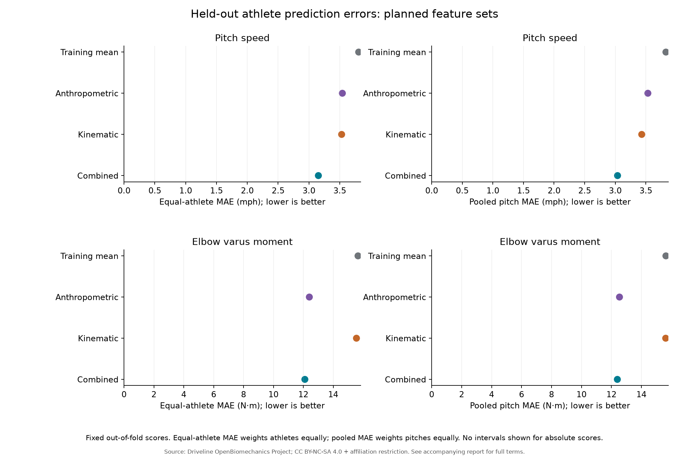
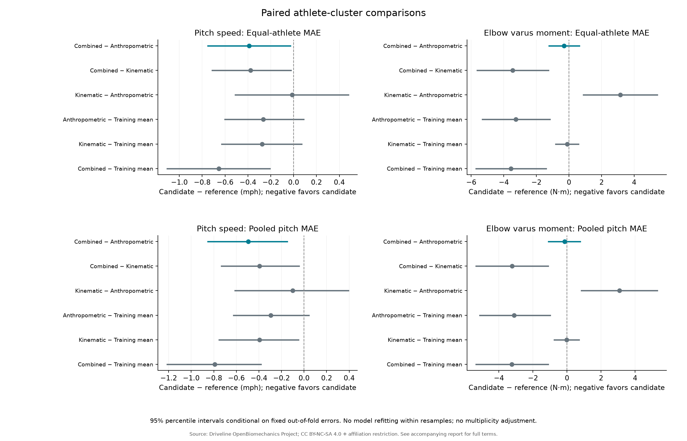
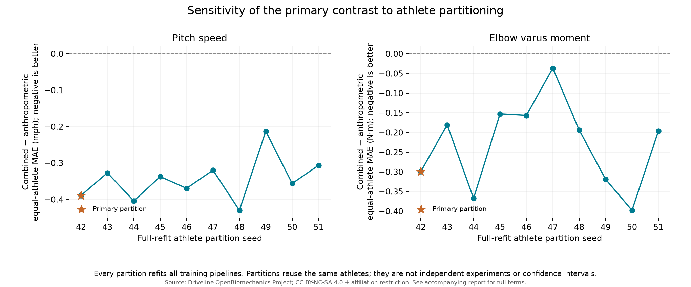

# Phase 2: Feature-set comparisons and conditional athlete-level uncertainty

> Generated from the saved Phase 2 evaluation tables. The exact producing code, frozen plan, and artifact hashes are recorded in [run_metadata.json](../assets/demo/reports/phase2/run_metadata.json). The source report and machine-readable tables are retained in [the reference snapshot](../assets/demo/reports/phase2/).

## Abstract

**Question.** Do fixed kinematic summaries add predictive information beyond age, mass, and height for pitch speed and peak internal elbow varus moment in held-out athletes from this source cohort?

**Methods.** Four planned baselines share 5 shuffled athlete-grouped folds (primary seed 42). Ridge alpha is fixed at 10. Primary comparisons use equal-athlete MAE, with 5,000 paired athlete-cluster resamples of fixed out-of-fold errors and 10 full-refit partition sensitivity analyses.

**Results.** Pitch speed: combined-minus-anthropometric equal-athlete MAE -0.389 mph (conditional 95% interval -0.749 to -0.029). Elbow varus moment: combined-minus-anthropometric equal-athlete MAE -0.299 N·m (conditional 95% interval -1.218 to 0.628).

**Interpretation.** This is an exploratory follow-on after viewing Phase 1 results, not a preregistered study or independent confirmatory evidence. The outcomes are performance and joint loading, with no injury labels or injury prediction.

## Question, plan, and eligible sample

The exact [frozen comparison plan](../analysis/phase2_plan.json) was recorded before these Phase 2 comparisons, after the Phase 1 results had already been viewed. Both outcomes and all planned contrasts are reported; no features, alpha, or winning outcome were chosen by scoring these comparisons.

| Outcome | Eligible pitches | Eligible athletes |
| --- | --- | --- |
| Pitch speed | 411 | 100 |
| Elbow varus moment | 411 | 100 |

Missing or nonfinite outcomes are omitted separately by target, never imputed or replaced from duplicate metadata. No outliers are removed. Model counts above are the actual saved eligible counts, not expected sample-size constants.

## Methods

The training-mean baseline is compared with anthropometric-only, kinematic-only, and combined ridge models. Anthropometrics are age, body mass, and height. Kinematics are peak shoulder internal rotation velocity, peak thorax–pelvis separation, and peak torso rotational velocity. Both outcomes, IDs, and filenames are excluded from every predictor set. These same-pitch summaries support retrospective prediction, not pre-pitch forecasting.

Athletes remain wholly within one held-out fold, with the same partitions across targets and models. Missing predictor handling and scaling are fitted only on training rows with observed targets in each fold. A model is refitted inside every fold and for every partition seed; no hyperparameter search is performed.

Equal-athlete MAE averages absolute errors within athlete, then averages athletes equally. Pooled pitch MAE weights every pitch equally. The primary contrast is **combined minus anthropometric equal-athlete MAE**, separately for both outcomes. Negative contrasts favor the candidate model. RMSE and R² are descriptive secondary scores; R² is undefined when the observed outcome has no variance.

The paired cluster percentile bootstrap draws athlete IDs with replacement 5,000 times (seed 20261019), retaining all eligible pitches and each sampled athlete's multiplicity. Identical athlete draws are used for paired models. Percentile intervals are computed separately for equal-athlete and pooled MAE contrasts.

**Interval scope:** intervals are conditional on fixed out-of-fold predictions and the observed source cohort. There is no refitting within bootstrap resamples. They exclude model-refitting, model-selection, and full training-set uncertainty. Overlapping cross-validation training folds also limit a sampling interpretation of these error intervals. No p-values, formal significance threshold, or multiplicity-adjusted confirmation are reported.

## All model scores

| Outcome | Model | Pitches | Athletes | Equal-athlete MAE | Pooled MAE | RMSE | R² |
| --- | --- | --- | --- | --- | --- | --- | --- |
| Pitch speed (mph) | Training mean | 411 | 100 | 3.807 | 3.828 | 4.735 | -0.010 |
| Pitch speed (mph) | Anthropometric | 411 | 100 | 3.542 | 3.533 | 4.473 | 0.099 |
| Pitch speed (mph) | Kinematic | 411 | 100 | 3.530 | 3.433 | 4.375 | 0.138 |
| Pitch speed (mph) | Combined | 411 | 100 | 3.153 | 3.037 | 3.876 | 0.323 |
| Elbow varus moment (N·m) | Training mean | 411 | 100 | 15.662 | 15.636 | 19.791 | -0.017 |
| Elbow varus moment (N·m) | Anthropometric | 411 | 100 | 12.404 | 12.538 | 16.289 | 0.311 |
| Elbow varus moment (N·m) | Kinematic | 411 | 100 | 15.557 | 15.622 | 20.128 | -0.052 |
| Elbow varus moment (N·m) | Combined | 411 | 100 | 12.104 | 12.395 | 15.885 | 0.345 |

Error scores retain the outcome's stated units. R² is dimensionless.

## Primary paired comparisons

Conditional 95% paired athlete-cluster percentile intervals; candidate minus reference, with negative values favoring the combined model.

| Outcome | Combined − anthropometric equal-athlete MAE | Conditional interval | Athletes |
| --- | --- | --- | --- |
| Pitch speed (mph) | -0.389 | [-0.749, -0.029] | 100 |
| Elbow varus moment (N·m) | -0.299 | [-1.218, 0.628] | 100 |

- **Pitch speed:** the combined model had lower observed held-out equal-athlete MAE than the anthropometric model; the signed difference was -0.389 mph. Its conditional interval does not include zero. This describes the saved prediction errors and does not establish a causal benefit of changing mechanics or an independent confirmation of model superiority.
- **Elbow varus moment:** the combined model had lower observed held-out equal-athlete MAE than the anthropometric model; the signed difference was -0.299 N·m. Its conditional interval includes zero. This describes the saved prediction errors and does not establish a causal benefit of changing mechanics or an independent confirmation of model superiority.

## Every planned contrast

Both error weightings are shown for all six planned model pairs and both outcomes. These exploratory intervals are not adjusted for multiple comparisons.

| Outcome | Candidate − reference | Metric | Difference | Conditional interval |
| --- | --- | --- | --- | --- |
| Pitch speed (mph) | Combined − Anthropometric | Equal-athlete MAE | -0.389 | [-0.749, -0.029] |
| Pitch speed (mph) | Combined − Anthropometric | Pooled pitch MAE | -0.496 | [-0.852, -0.149] |
| Pitch speed (mph) | Combined − Kinematic | Equal-athlete MAE | -0.377 | [-0.714, -0.024] |
| Pitch speed (mph) | Combined − Kinematic | Pooled pitch MAE | -0.395 | [-0.733, -0.045] |
| Pitch speed (mph) | Kinematic − Anthropometric | Equal-athlete MAE | -0.012 | [-0.511, 0.479] |
| Pitch speed (mph) | Kinematic − Anthropometric | Pooled pitch MAE | -0.100 | [-0.612, 0.392] |
| Pitch speed (mph) | Anthropometric − Training mean | Equal-athlete MAE | -0.264 | [-0.601, 0.088] |
| Pitch speed (mph) | Anthropometric − Training mean | Pooled pitch MAE | -0.295 | [-0.624, 0.042] |
| Pitch speed (mph) | Kinematic − Training mean | Equal-athlete MAE | -0.276 | [-0.629, 0.071] |
| Pitch speed (mph) | Kinematic − Training mean | Pooled pitch MAE | -0.395 | [-0.752, -0.050] |
| Pitch speed (mph) | Combined − Training mean | Equal-athlete MAE | -0.654 | [-1.107, -0.207] |
| Pitch speed (mph) | Combined − Training mean | Pooled pitch MAE | -0.790 | [-1.214, -0.381] |
| Elbow varus moment (N·m) | Combined − Anthropometric | Equal-athlete MAE | -0.299 | [-1.218, 0.628] |
| Elbow varus moment (N·m) | Combined − Anthropometric | Pooled pitch MAE | -0.142 | [-1.081, 0.773] |
| Elbow varus moment (N·m) | Combined − Kinematic | Equal-athlete MAE | -3.453 | [-5.638, -1.253] |
| Elbow varus moment (N·m) | Combined − Kinematic | Pooled pitch MAE | -3.227 | [-5.335, -1.108] |
| Elbow varus moment (N·m) | Kinematic − Anthropometric | Equal-athlete MAE | 3.153 | [0.880, 5.422] |
| Elbow varus moment (N·m) | Kinematic − Anthropometric | Pooled pitch MAE | 3.084 | [0.845, 5.306] |
| Elbow varus moment (N·m) | Anthropometric − Training mean | Equal-athlete MAE | -3.258 | [-5.318, -1.162] |
| Elbow varus moment (N·m) | Anthropometric − Training mean | Pooled pitch MAE | -3.099 | [-5.125, -0.991] |
| Elbow varus moment (N·m) | Kinematic − Training mean | Equal-athlete MAE | -0.105 | [-0.818, 0.585] |
| Elbow varus moment (N·m) | Kinematic − Training mean | Pooled pitch MAE | -0.014 | [-0.741, 0.701] |
| Elbow varus moment (N·m) | Combined − Training mean | Equal-athlete MAE | -3.557 | [-5.700, -1.393] |
| Elbow varus moment (N·m) | Combined − Training mean | Pooled pitch MAE | -3.241 | [-5.338, -1.102] |

## Partition sensitivity

All training pipelines are refitted for seeds 42, 43, 44, 45, 46, 47, 48, 49, 50, 51. The same athletes and pitches recur across partitions. These are descriptive sensitivity analyses, not independent experiments, additional independent cohorts, or confidence intervals. No standard error is calculated by treating partition seeds as independent replicates.

- Pitch speed: primary equal-athlete MAE contrast ranged from -0.430 to -0.213 mph; negative in 10 of 10 saved partitions.
- Elbow varus moment: primary equal-athlete MAE contrast ranged from -0.398 to -0.037 N·m; negative in 10 of 10 saved partitions.

| Outcome | Model | Equal-athlete MAE range | Pooled MAE range |
| --- | --- | --- | --- |
| Pitch speed (mph) | Training mean | 3.807 to 3.854 | 3.822 to 3.878 |
| Pitch speed (mph) | Anthropometric | 3.503 to 3.680 | 3.489 to 3.657 |
| Pitch speed (mph) | Kinematic | 3.530 to 3.752 | 3.432 to 3.638 |
| Pitch speed (mph) | Combined | 3.147 to 3.467 | 3.026 to 3.323 |
| Elbow varus moment (N·m) | Training mean | 15.566 to 15.847 | 15.546 to 15.835 |
| Elbow varus moment (N·m) | Anthropometric | 11.735 to 12.404 | 11.888 to 12.538 |
| Elbow varus moment (N·m) | Kinematic | 15.422 to 16.006 | 15.478 to 15.971 |
| Elbow varus moment (N·m) | Combined | 11.577 to 12.104 | 11.806 to 12.395 |

## Biomechanical and statistical limits

A lower prediction error identifies an association in this dataset, not a causal mechanical intervention. Peak variables need not occur at the same instant and do not establish sequencing or energy transfer. Internal net elbow varus moment is not tissue-specific force, injury probability, or a safe threshold. There are no injury outcomes. The small, predominantly collegiate fastball cohort and its measurement setting limit transport to professional players, other pitch types, and future sessions. No new camera alignment, video-derived moment estimation, or external validation was performed in this phase.

The next defensible extension is an appropriately licensed independent or longitudinal cohort. Model tuning would require a separate, nested athlete-grouped evaluation; it should not reuse these displayed errors as an unbiased test set.

## Reproducibility and source attribution

This report only reads saved evaluation artifacts; it does not fit models or download data. Reproduction settings are in [phase2_plan.json](../analysis/phase2_plan.json). Machine-readable scores, paired contrasts, per-athlete errors, partition results, and provenance accompany this report. Numeric display is rounded to three decimals; saved CSV files preserve computational precision.

Source: Driveline Baseball Research & Development and Kyle Boddy, [The OpenBiomechanics Project](https://github.com/drivelineresearch/openbiomechanics/tree/44b98dae05cceb016f080ab39d105c85b8639084), commit `44b98dae05cceb016f080ab39d105c85b8639084`. Adaptations by this project include joins, feature-set comparisons, grouped evaluation, conditional bootstrap summaries, and figures. No endorsement is implied.

Data and derived reports/figures retain [CC BY-NC-SA 4.0](https://creativecommons.org/licenses/by-nc-sa/4.0/) plus the [additional upstream affiliation restriction](https://github.com/drivelineresearch/openbiomechanics/blob/44b98dae05cceb016f080ab39d105c85b8639084/LICENSE-DATA.md):

> Any employee or contractor employed by, associated with, or a significant shareholder of a professional sports organization or financial analysis firm is forbidden to use The OpenBiomechanics Project data for any use whatsoever.

A specific written paid license is required for such use. The original software's MIT license does not override data and derived-material restrictions.
